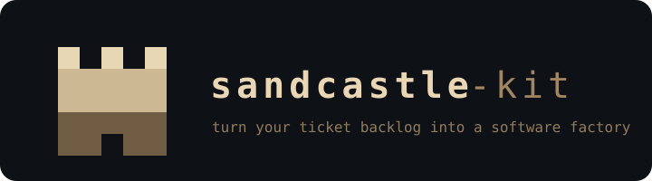
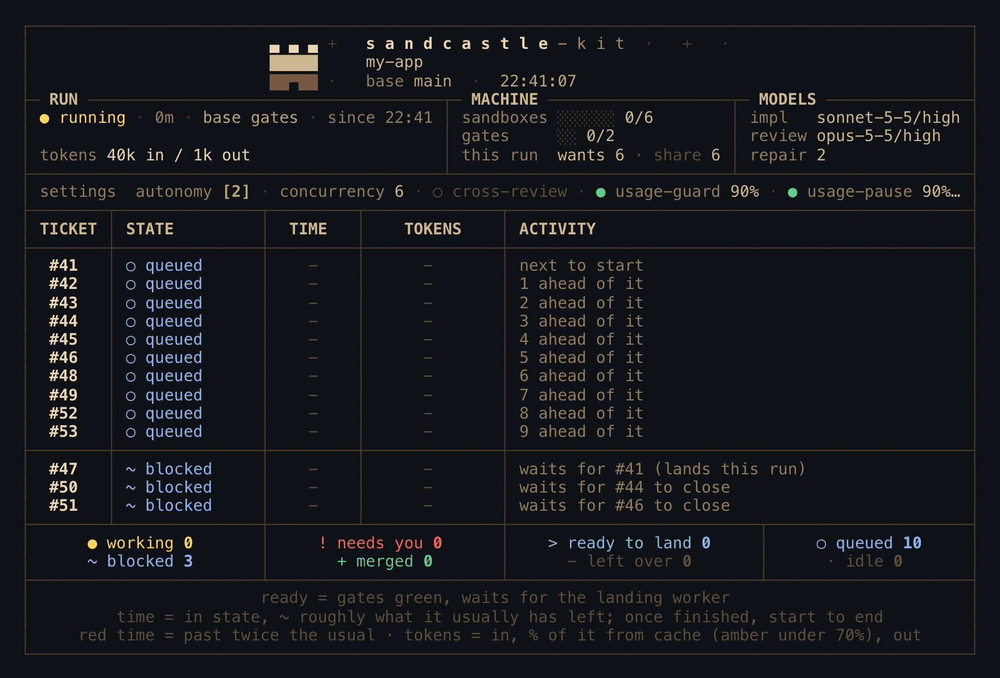
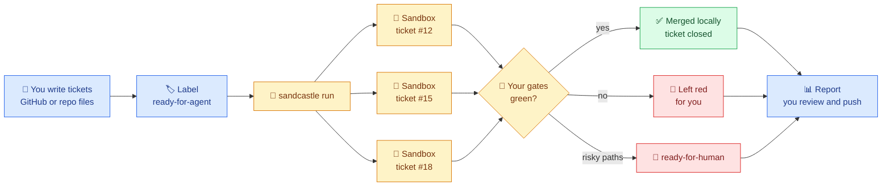

<div align="center">

<a href="https://henkisdabro.github.io/sandcastle-kit/"></a>



Unattended coding agents burn down your queue of GitHub issues or ticket files in Docker sandboxes - implemented, reviewed,
gated and merged while you are away from the keyboard.

[](https://github.com/mattpocock/sandcastle)
[](LICENSE)
[](.github/workflows/secret-scan.yml)
[](https://github.com/henkisdabro/sandcastle-kit/releases/latest)

[](https://docs.anthropic.com/en/docs/claude-code)
[](https://github.com/openai/codex)
[](docs/INSTALL.md#-requirements)
[](https://nodejs.org)
[](tsconfig.json)
[](https://pnpm.io)

[Website](https://henkisdabro.github.io/sandcastle-kit/) · [Who it is for](#-who-is-this-for) · [Quick start](#-quick-start) · [How it works](#-how-it-works) · [Docs](#-documentation) · [Mark tickets ready](docs/queue.md#-how-to-mark-a-ticket-ready) · [Run](docs/running.md#-run) · [Herdr](docs/herdr.md#-works-best-in-herdr) · [Safety](docs/safety.md#-safety-model) · [Troubleshooting](docs/troubleshooting.md#-troubleshooting)

</div>

> [!NOTE]
> sandcastle-kit is an opinionated ticket-burndown kit built on
> **[Sandcastle](https://github.com/mattpocock/sandcastle) by [Matt Pocock](https://github.com/mattpocock)**.
> Sandcastle does the heavy lifting - sandboxing, worktrees and agent orchestration. This kit is
> one way to put it to work, learned from and improved on with gratitude.

Sandcastle runs coding agents in Docker sandboxes. This kit turns it into a ready-made loop for
any repository whose tickets are GitHub Issues or Markdown files in the repo: it picks up tickets
marked `ready-for-agent`, has one agent implement each ticket and a stronger one review it, runs
your project's own lint/build/test gates itself (an agent never gets to say "tests pass"), merges
what is green and closes the ticket. One install serves all your projects; each project adds a
small config file.

## 🙋 Who is this for?

**In one line:** developers who already work with Claude Code or Codex, keep their to-do list as
tickets, and want the well-specified ones done while they are away from the keyboard.

**It is a good fit if you:**

- 🧑‍💻 are a solo developer, freelancer or small team with a backlog of clear, small-to-medium
  tickets - bug fixes, small features, refactors, test coverage, dependency and docs chores;
- 🗂️ track work in **GitHub Issues**, or as **Markdown files in the repo** (including the
  `.scratch/` layout from [Matt Pocock's skills](https://github.com/mattpocock/skills), if you use them - you do not have to);
- ✅ have real **gates** - lint, typecheck, tests, a build - that a machine can run. They are how the kit
  knows work is good, so the better your tests, the more you can hand over;
- 🖥️ have a Mac with OrbStack or Docker Desktop, or a Linux machine with rootful Docker Engine, and a Claude subscription or API key;
- 🌙 are happy to come back to a report and review what merged, rather than watch it happen.

**It is probably not for you if:**

- your tickets are vague ("make it faster", "improve onboarding") - an unattended agent with no chat
  context needs a closed spec, and the [queue step](docs/queue.md#-queue-what-agents-work-on) helps you write one;
- the repo has no automated checks - nothing then stands between an agent's guess and your base branch;
- you want an agent pair-programming with you live (use Claude Code directly), or work that needs a
  production system, a device or a secret the sandbox must not have;
- your tickets live only in Linear, Jira or another tool. Linear issues can be *blockers* today, and
  the [tracker interface](docs/queue.md#-trackers-github-or-ticket-files) is built for more, but only GitHub and ticket files are queues so far.

**What a day looks like:** in the morning you write or triage a handful of tickets and mark them
ready. You start a run and go about your day. When you are back there is a report: which tickets
merged into your local base branch (nothing is ever pushed), which are red and why, and which
need you. You review and push what you like, land a branch you fixed or requeue a ticket with a
note, and repeat.

**Do I need anyone else's tools?** No: Docker, Node, pnpm, git and, for GitHub tickets, the `gh`
CLI. [Matt Pocock's skills](https://github.com/mattpocock/skills) are recommended (the tip in the
quick start says why), never required.

### 📖 The words used here

<details>
<summary>New to GitHub or to agents? The only terms you need.</summary>

| Word | Plain meaning |
|---|---|
| **Ticket** | One piece of work, written down: a title, a description of what should change, and how you will know it is done. On GitHub a ticket is an **issue**; in the files tracker it is a Markdown file. |
| **GitHub issue** | GitHub's built-in ticket: a page in your repository (the **Issues** tab) with a title, a description and a comment thread. |
| **Label** | A coloured tag you stick on a GitHub issue, such as `bug` or `ready-for-agent`. Labels are how this kit knows which tickets to work on: it only touches the ones carrying its queue label. |
| **`ready-for-agent`** | The kit's default queue label. It means "an agent may do this without asking me anything". Putting it on a ticket is you saying yes. [How to add it](docs/queue.md#-how-to-mark-a-ticket-ready). |
| **Queue** | Every ticket currently marked `ready-for-agent`. A run works through it. |
| **Gate** | A command that must pass before anything merges: your linter, type checker, tests, build. You list them once in `config.ts`. |
| **Sandbox** | A throwaway Docker container in which one agent works on one ticket, on its own git branch, so it cannot touch your machine or other tickets. |
| **Base branch** | The branch (usually `main`) that green work is merged into, locally. Nothing is pushed. |
| **`ready-for-human`** | Added by the kit when a change is risky or a ticket cannot be finished unattended. It takes the ticket out of the queue until you look. (Earlier versions called it `needs-human`; a ticket carrying that is still held.) |
| **`needs-triage`** | Put by the kit on the follow-up tickets it files from the agents' `<followup>` lines (a label on GitHub, a `Status:` in ticket files). Never queued by itself: the closing summary lists them for you to triage. |

</details>

> [!TIP]
> **AI coding agent?** Start at [the section written for you](#-if-you-are-an-ai-coding-agent-reading-this), then run `sandcastle doctor`.

## ⚡ Quick start

**You need:** macOS or Linux, Node 22.18+, pnpm, git, `ps` (procps, on Linux), the GitHub CLI signed in (`gh auth login`;
skippable if your tickets are files in the repo), and a container runtime - [OrbStack](https://orbstack.dev) on macOS ([Podman](https://podman.io) is untested there),
rootful [Docker Engine](https://docs.docker.com/engine/install/) on Linux, run as a normal user in the docker group
(rootless Docker and Podman on Linux are not supported yet).
[Full requirements](docs/INSTALL.md#-requirements).

**1. Install the kit** (once per machine) - one line, paste it into your terminal:

```bash
git clone https://github.com/henkisdabro/sandcastle-kit.git ~/sandcastle-kit && cd ~/sandcastle-kit && pnpm install && ./bin/sandcastle setup
```

`setup` puts the `sandcastle` command on your PATH, installs the agent skill, walks you through
your Claude and GitHub tokens, and finishes with a health check. Re-run it any time.
([What it does, and doing it by hand](docs/INSTALL.md).)

**2. Point it at a project:**

```bash
cd ~/code/your-project
sandcastle init              # or ask your agent: /sandcastle init
sandcastle build
```

`init` fills in the gate commands (`lint`, `test`, ...) from your stack; check them against CI in
`.sandcastle/config.ts` - see [Set up a project](docs/setup.md#-set-up-a-project).

> [!TIP]
> **Recommended, optional:** install [Matt Pocock's skills](https://github.com/mattpocock/skills) too
> and run `/setup-matt-pocock-skills` in your project. The kit understands the tracker and labels it
> records, and his `/grill-with-docs`, `/to-tickets` and `/triage` are a good way to write the tickets
> this kit works through. Nothing here requires them.

**3. Mark some tickets `ready-for-agent` - on GitHub that is a label you add to an issue ([step by step](docs/queue.md#-how-to-mark-a-ticket-ready), no experience needed); in ticket files it is a `Status:` line ([Trackers](docs/queue.md#-trackers-github-or-ticket-files)) - and try a dry run:**

```bash
DRY_RUN=1 sandcastle run     # implement, review, gate - never merge or close
```

---

## 💡 Why sandcastle-kit?

You already drive Claude Code or Codex every day - maybe with subagents, maybe several sessions
side by side. That still needs **you** in the loop: approving prompts, watching terminals, copying
context between chats. sandcastle-kit is the next step up.

- 🎫 **Your tickets stay where they are.** GitHub Issues or Markdown files in the repo: write a
  ticket an agent could finish with no chat context, mark it ready, and it joins the queue. No new
  tool to learn.
- 🏭 **A software factory per repository.** Each queued ticket gets its own git worktree and its
  own Docker sandbox, several at once, across several projects.
- 🧪 **Proof, not promises.** The orchestrator - not the agent - runs your gates. Only green
  branches merge, and the merged base branch is gated again.
- 🔒 **Safe to leave unattended.** Agents run with permission prompts off, but inside a container
  with a token that cannot push, and risky changes wait for a human.
- ☕ **You come back to a report**: what merged, what is red, what needs you. Nothing is pushed
  until you push it.



## ✨ What it adds to Sandcastle

| | Feature | What you get |
|---|---|---|
| 🚦 | **Gates run by the orchestrator** | Your lint, typecheck, tests and build, run after the agents in the sandbox. Only green branches merge, and an agent never gets to say "tests pass". |
| 🧱 | **A green base first** | Every gate runs on the base commit before any agent starts: a gate red there would be red on every branch. |
| 🩹 | **Repair on red** | A red gate runs once more (a flake goes on as green), then gets bounded repair passes fed the gate's output; a repaired branch is reviewed again. |
| 🧑‍💻 | **Implement, then review** | Claude Sonnet 5.5 implements, Claude Opus 5.5 reviews the tests and the code. A `model:` label changes one ticket's implementer; `CROSS_REVIEW=1` adds Codex. |
| 🗂️ | **Your tracker** | GitHub Issues or Markdown ticket files, with blockers from GitHub, Linear or ticket files. |
| 🛬 | **Landing you control** | Each ticket lands as it goes green while the others run; a conflict gets one more try. `preview`, `land` and `requeue` between runs. |
| 🔒 | **Host safety** | Fine-grained tokens only, host git hooks off, the shared `.git` fingerprinted, risky branches held for a person. |
| ⚖️ | **Machine-wide limits** | Several projects' runs share the machine's sandbox and gate slots without starving each other. |
| 📺 | **A live status view** | `sandcastle status`: every ticket and where it is, which gate is running, when landing should start. |
| 🖥️ | **Best in [Herdr](https://herdr.dev)** | The status view and the run in the sidebar, in Herdr TUI and in the Herdr app. |
| 🔭 | **A Claude Code mod** | Optional: the run above the prompt of the session that started it, a needs-you notice, a prompt when it ends. |
| 🧩 | **An agent skill** | `/sandcastle` in Claude Code, `$sandcastle` in Codex, also read by OpenCode: setup, audit, triage, runs and updates. |

Each feature in full, with the run's flowchart: [How a run works](docs/how-it-works.md).

## 🔄 How it works

A run starts in a project, on its base branch, with a clean tree:

1. **Checks** - the token type, the images (built if stale), one short reply from each model, the hook check, the `.git` fingerprint.
2. **The base** - every gate on the base commit. Red stops the run before any agent starts.
3. **Per ticket**, in its own git worktree and Docker sandbox, up to `CONCURRENCY` at once - an implement agent, a review agent, then your gates, run by the orchestrator, with repair passes on red.
4. **Landing** - a green branch is merged into the local base branch and its ticket closed; a branch that touches hooks, CI or install scripts is held for a person.
5. **The end** - the merged base is gated once more, and the closing summary says what merged, what is red and what needs you. Nothing is pushed.

A green gate run proves only that the configured gate commands passed on that branch - no more than those commands check. Whether the change does what the ticket asked is the review agent's job, which is why every branch is reviewed before it is gated.

The gates also run in the Linux sandbox, so a green run proves Linux only. A branch can still be red on macOS or Windows (BSD tools, bash 3.2, shell shims and terminal flags differ), and landing does not check that: it gates in the same Linux sandbox. A project that ships to macOS or Windows can add a CI job on that OS, or run its gates on the host before pushing.

## 📚 Documentation

Read the one your question is about:

| Doc | Read it to |
|---|---|
| [Install](docs/INSTALL.md) | check the requirements, see what `setup` does, install or update by hand |
| [Setting up a project](docs/setup.md) | run `init`, choose the gates, extend the Dockerfile, decide what a sandbox keeps of the project's skills and hooks |
| [Tickets and the queue](docs/queue.md) | write a ticket an agent can finish, mark it ready, add blockers, keep tickets in files |
| [Running](docs/running.md) | start, detach, pause or stop a run, read the closing summary, land or re-run a ticket |
| [Commands](docs/commands.md) | look up a command or flag in full |
| [Configuration](docs/configuration.md) | look up a `config.ts` key, a personal setting or an environment variable |
| [Concurrency](docs/concurrency.md) | size the machine pool, run several projects at once |
| [Safety model](docs/safety.md) | see what an agent can reach, and what holds a branch for you |
| [Herdr](docs/herdr.md) | watch a run from Herdr TUI or the Herdr app, or set up the plugin |
| [The Claude Code mod](docs/claude-mod.md) | see the run in the session that started it |
| [Troubleshooting](docs/troubleshooting.md) | match a failure to its fix |
| [How a run works](docs/how-it-works.md) | read every feature in full, with the run's flowchart |
| [Architecture](docs/architecture.md) | change the kit itself |

## 🧰 Commands

Run them from inside a project; `sandcastle help` lists them, `sandcastle <command> --help` explains one, and [Commands](docs/commands.md) has each in full.

| | |
|---|---|
| **Set up** | `setup` (install), `doctor` (check, with the fix for each problem), `init` (scaffold a project), `build` (images), `lean` (what a sandbox keeps), `gates` (every gate on the base) |
| **Tickets** | `queue` (what is ready, and what holds the rest back), `queue --lint` (the queue's shape before a run), `blockers`, `requeue <n> --note "..."` |
| **Run** | `run` (with `--detach` for a run that outlives your terminal), `wait`, `status`, `pause`, `resume`, `stop`, `cap`, `report` |
| **After a run** | `preview` (which branches would conflict), `land <n>`, `clean` |
| **Machine and kit** | `size` (the pool's limits), `usage` (the plan's usage), `preflight` (one reply from each model), `changes` and `updated` (after a kit update) |

Only `run`, `preflight` and `lean --measure` call a model.

## 📥 Updating

In each project, ask your agent for `/sandcastle update`. It pulls the kit, rebuilds the images,
re-runs the hook check and the base gates, and walks you through anything in [`CHANGELOG.md`](CHANGELOG.md)'s
**Upgrading** notes that affects that project. Existing configs keep working: a new field is
always optional. [By hand](docs/INSTALL.md#-updating).

## 🤖 If you are an AI coding agent reading this

You are probably helping a user who cloned this repository. This section is the whole mental
model; `sandcastle help` lists every command, and the [Documentation](#-documentation) table says
which file holds each topic.

**Three places, each with one job:**

| Place | Holds | Edited by |
|---|---|---|
| **The kit** - this repository, cloned once per machine | Orchestrator, prompts, base image, status view, the `/sandcastle` skill. Shared by every project and possibly public, so it stays generic: no credentials, names or project details. | Nobody, in normal use |
| **User config** - `~/.config/sandcastle-kit/` | `.env` (every token, including `LINEAR_API_KEY`), optional `config.json` ([personal settings](docs/configuration.md#personal-settings): machine-wide limits, keep-awake, notify) and `denylist` | The user, once. Not committed anywhere |
| **Each project** - the repository the agents work on | `.sandcastle/config.ts`, `rules.md`, optional `Dockerfile`, optional `config.local.json` ([your clone's own run settings](docs/configuration.md#-configuration), gitignored); generated `logs/`, `worktrees/`, `.run/`, `triage/` (gitignored; [what is in them](docs/running.md#-what-a-run-leaves-behind)) | You and the user, when setting the project up |

Run `sandcastle` from inside a project. `sandcastle doctor` also works anywhere.

**Start with `sandcastle doctor`.** It prints `ok`, `opt` or `FIX` for each requirement, with the
exact command under every `FIX`. Any failure later starts there too, then [Troubleshooting](docs/troubleshooting.md#-troubleshooting).

**Match the request, then check its finish line:**

| The user says | Do this | Finished when |
|---|---|---|
| "set this up", "install sandcastle-kit", a fresh clone | Ask the user to run `./bin/sandcastle setup` in their own terminal (it asks for tokens only they can create). Then fix each `FIX` line in order. [docs/INSTALL.md](docs/INSTALL.md) has the manual steps. | `sandcastle doctor` ends "All required checks pass." |
| "use sandcastle in this project" | [Set up a project](docs/setup.md#-set-up-a-project), or `/sandcastle init` with the user. | `sandcastle gates` is green on the base branch |
| "which issues can the agents do?", "triage for sandcastle" | `sandcastle queue` first: it names the tracker and queue label in use. Then `/sandcastle queue`, or [Queue](docs/queue.md#-queue-what-agents-work-on) by hand. | Every open ticket is queued, decided with the user, or left with a reason |
| "find work for the agents", "audit this repo", "we have no issues yet" | `/sandcastle audit`: read-only review agents per lens, findings de-duplicated and triaged by the queue criteria, filed with the user's yes. Costs interactive allowance, no sandbox. | Every finding is filed, merged or dropped with a reason |
| "our tickets are in files / Linear", "we use Matt Pocock's skills" | [Trackers](docs/queue.md#-trackers-github-or-ticket-files). Read `docs/agents/issue-tracker.md` if it exists; set `tracker` in `config.ts` only when the detected one is wrong. Linear is a blocker source, not a queue. | `sandcastle queue` lists the tickets the user expects |
| "start a run", "burn down the queue" | [Run](docs/running.md#-run), detached: `sandcastle run --detach`, then `sandcastle wait` as a background command ([Detached runs](docs/running.md#-detached-runs)); a run takes hours. | `sandcastle wait` has returned, and you have read the closing summary |
| "pause the run", "hold it", "carry on" | `sandcastle pause`, then `sandcastle status 0`; `sandcastle resume` to carry on ([Pausing a run](docs/running.md#-pausing-a-run)). A hold is a pause, never `sandcastle stop`, which ends the passes in flight mid-way: ask first. | The status view reads `PAUSED`, or no longer does after the resume |
| "is it working?", "how did the run go?" | `sandcastle status 0` while it runs; `sandcastle report` after. Logs are in `.sandcastle/logs/`. | You can name each ticket's phase, or have relayed the summary |
| "land this branch", "try that ticket again" | [After a run](docs/running.md#-after-a-run): `sandcastle preview`, `sandcastle land <n>`, `sandcastle requeue <n> --note "..."`. Each changes the base branch or the tracker: ask first. | The ticket is closed with the kit's merge, or queued with the note |
| "update sandcastle" | `/sandcastle update`, or [Updating](docs/INSTALL.md#-updating). `CHANGELOG.md` says what changed. | The kit is pulled and `sandcastle doctor` is green in the project |

**Ask the user first** for anything that spends allowance or changes their repo:
`sandcastle run`, `preflight` and `lean --measure` call the model; a run also merges into the base
branch locally and updates the tickets (GitHub, or commits to ticket files), as `land` and
`requeue` do for one ticket. Nothing here pushes.

**Keep the safety rules intact** (token type, protected paths, hook checks). When one blocks a run,
fix its cause or ask the user.

## 🤝 Contributing to the kit

`AGENTS.md` has the layout and conventions. This repository is public and used daily by its
maintainer, so nothing personal, client-specific or secret may be committed: enable the guard with
`git config core.hooksPath .githooks` (requires `gitleaks`; add your own denylist at
`~/.config/sandcastle-kit/denylist`, and in `allowlist` beside it the few lines you mean to
publish anyway, such as an author credit). CI scans every push for secrets.

## 🙏 Credits and licence

Built on **[Sandcastle](https://github.com/mattpocock/sandcastle)** by
**[Matt Pocock](https://github.com/mattpocock)**, which does all the sandboxing, worktree and agent
orchestration underneath; this kit is one opinionated way to use it. Sandcastle's own templates
are the place to start if you want to build your own workflow. If this kit helps you, go and star
the original.

MIT - see [`LICENSE`](LICENSE). Sandcastle's licence is reproduced in [`NOTICE`](NOTICE).

Built by [Henrik Söderlund](https://www.henriksoderlund.com/?utm_source=github&utm_medium=referral&utm_campaign=oss-sandcastle-kit&utm_content=readme-author-link).
