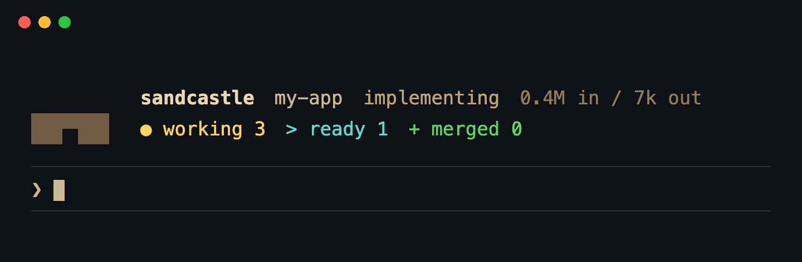

# 🔭 The Claude Code mod

The optional Claude Code mod: the live band, the needs-you notice, the end prompt, the cache
refresh, and what it touches.


Most runs start from a Claude Code session, with `/sandcastle run`. With the kit's
[mod](https://code.claude.com/docs/en/plugins/mods/overview) linked, that session shows the run
itself, in the status view's castle, glyphs and colours:

<p align="center"></p>

- 🏰 **A band above the prompt** while a run is alive: the status view's three-row castle, the
  run's stage and tokens beside its walls, the legend's counts beside its base. While a ticket is
  in work the castle builds from the sand up and holds; otherwise it stands still. In a narrow
  terminal the legend keeps its glyphs and drops its words. It is gone when the run ends.
- 🙋 **A pinned line and a notice** when a ticket comes to need a person - a conflict, a red
  gate, a held branch, a crash - naming the tickets. The line stays until they are dealt with or
  the run ends.
- 🏁 **A prompt when the run ends.** The session where you used `/sandcastle` hears that the run's
  process is gone - after the report, a drained queue, a crash or Ctrl-C, or a run that died seconds
  after it started - and closes the run with the closing summary (the seven sections, or a short
  hand-back when asked).
  It needs no Herdr and no `sandcastle wait`.
  The prompt names the run by its pid and start time, so a prompt that arrives after a later run has
  begun is closed from the run it names, not the live one.
  It follows the run that session started wherever its project is - a second clone of the
  repository, a package of a monorepo - because every run records the id of the Claude Code session
  that started it (and only the id).
  A run started from a plain terminal, Codex or OpenCode has no such session: the mod shows it only
  in the session's own project, and the skill's `sandcastle wait` covers the rest.
  A session you quit and resumed in the meantime hears it when it comes back; after `/clear` the
  terminal you started from still hears it.
- 🏷️ **An idle mark between runs.** In a project `sandcastle init` has set up - its
  `.sandcastle/config.ts` is a plain file; a stray `.sandcastle/` directory does not count - the mod
  draws the word `sandcastle` in sand, one quiet row above the prompt led by a small castle tower
  (`♜`), so the session shows the project takes runs.
  (It is the mod's own row, not Claude Code's status line: that one carries a warning triangle and a
  notice colour the mod cannot change, and is kept for what needs you.) The live band replaces it
  while a run is alive - the session's own project's, or one it follows in another directory - and
  it returns after the end notice.
  Its count is always the session's own project's.
  When **ready tickets** wait - queued tickets with no open blocker, the ones a run would start now -
  it reads `sandcastle · 4 ready - /sandcastle run`.
  The kit version leads the line once the mod has read it,
  `sandcastle 0.16.0 · 4 ready - /sandcastle run` (a clone past its release tag shows how far,
  `0.16.0+3`).
  When the project has Upgrading notes it has not had, or no usable update record on this machine
  (one set up before records existed, or on another machine), the line says so and points at the
  update: `sandcastle 0.17.0 · 4 ready · update needed - /sandcastle update`, `update needed` in
  brighter sand and bold.
  When a newer release of the kit is tagged on its remote, that comes first:
  `sandcastle 0.16.0 · 4 ready · 0.17.0 out - /sandcastle update` (only when the newest release is
  newer than the kit's own release; a clone past its tag counts).
  The line says nothing about the project while it is current, whatever release it last updated at.
  The version, the newest release and the project's state come from `sandcastle --version --json`,
  which also works outside a project and is read like the queue: in the background, on the same
  ten-minute schedule and triggers (the end of a `/sandcastle update` turn drops the hint), never in
  a project that is not set up or while the mark is hidden.
  The newest release is the highest `vX.Y.Z` tag that `git ls-remote --tags` finds on the kit
  checkout's `origin` (never a fetch, no prompt, killed at 10 seconds), kept machine-wide under the
  kit's cache directory: a good read holds six hours, a failed one is tried again after an hour, and
  a failure shows no release rather than the last one.
  `"updateCheck": false` in your [personal settings](configuration.md#personal-settings) stops the read, and
  `sandcastle doctor` names the release too, in an `info` line.
  The count comes from `sandcastle queue --json`, read in the background and cached once per project
  in the mod's store, shared by every Claude Code session on the machine: at most one tracker read
  per project every 10 minutes while nothing changes, plus one when a run of the project, or one the
  session follows, ends and one when you use `/sandcastle` (it may just have labelled tickets).
  A read that fails or takes over 20 seconds (offline, rate-limited, signed out of `gh`) keeps the
  last good count for an hour and then shows the bare mark; the line never shows an error -
  `sandcastle queue` and the status view explain one.
  Turn the mark off for every project with `"idleMark": false` in your [personal
  settings](configuration.md#personal-settings), or in one project with `/sandcastle-mark hide`.
- 🔕 **`/sandcastle-mark`**: your say over the idle mark, with no model turn.
  - `dismiss` takes the count off while you have seen it: the line reads plain `sandcastle` until
    a ticket that was not ready becomes ready, which brings the count back. A ticket leaving the
    ready set does not. The mark itself stays. It also quiets `N out` until a release newer than
    that one is tagged; a newly ready ticket does not bring the release back, nor a newer release
    the count. `update needed` has no dismissal, so a dismissed release shows it when Upgrading
    notes are pending.
  - `hide` turns the mark off in this project until `show`; `show` undoes hiding and both
    dismissals.
  - With no argument it says whether the mark is shown, hidden (here or machine-wide) or
    dismissed, and the cached count with its age, so a stale count can be told from an empty
    queue. It also reports the full kit version (the commit and local changes too), the release
    this project last updated at, the Upgrading notes it has not had (or that none are held) and
    the newest release with when it was checked - the facts last read, even while the mark is
    hidden. Any other argument prints the usage line.

  The choices are kept in the mod's store under the project root: on your machine only, across a
  restart, and never in the repository. The machine-wide `idleMark` switch stays in your personal
  settings, which the mod never writes.
- 📋 **`/sandcastle-status`**: every ticket and where it is, as text, with no model turn. It
  answers while Claude is working.

It is optional. `sandcastle setup` offers it, and `sandcastle doctor` prints the one command that
links it (`ln -sfn <kit>/mod ~/.claude/skills/sandcastle-mod`); `rm
~/.claude/skills/sandcastle-mod` takes it out, and `/plugin` in Claude Code turns it off without
unlinking it. It needs Claude Code 2.1.287 or newer.

Three things to know:

- **Mods are early access in Claude Code.** Their API can change between releases, and Claude
  Code can turn mods off from its side; `sandcastle doctor` then says so in Claude Code's own
  words. Nothing depends on the mod: without it the skill waits for the run's end its own way,
  and the status view, the Herdr tab and `notify` work as before.
- **It draws in the terminal and, by Claude Code's account, in the Desktop app's Code tab.**
  Elsewhere - the VS Code panel, `claude -p` - Claude Code draws nothing for a mod, though its
  hooks still run, so `/sandcastle-status` answers there. Codex and OpenCode have no mods; the
  skill behaves there as it always has.
- **It stays out of the way.** In a project with no `.sandcastle/` it does nothing at all. It
  never opens a pane and never moves focus. Only a session where you used `/sandcastle` gets
  the closing prompt, and of two such sessions in one project, the later one.

## What the mod touches

A mod is code that runs inside Claude Code with your permissions, not in a sandbox, so here is
all of it. The mod:

- reads `.sandcastle/logs/run.json` under the session's project root, after checking that
  `.sandcastle/` exists and that the record is a plain file, not a link;
- checks that `.sandcastle/config.ts` is a plain file (one `stat`) for the idle mark, and runs
  one `sh` script (`cat`, no writing) that prints your personal `config.json` for its `idleMark`
  switch. It never writes that file;
- once a project is set up and the mark is on, runs `sandcastle queue --json` there for the ready
  count - the kit's own `bin/sandcastle` beside the mod, else the `sandcastle` on your PATH - with
  a 20 second timeout, one at a time per session, and keeps the ids in its store (one entry per
  project, shared by every session). That read is the one place the mod reaches the tracker, and
  it does it through the kit, never itself. It makes none while an entry under 10 minutes old
  stands, except when you use `/sandcastle` and again when that turn ends (triage labels tickets
  in between);
- in the same cases, runs `sandcastle --version --json` there for the kit version, the project's
  update state and the kit's newest release, with the same 20 second timeout and one entry per
  project in its store. The kit, not the mod, looks the newest release up: `git ls-remote --tags` on
  the kit checkout's `origin`, at most once in six hours, off with `"updateCheck": false`. A few
  local `git` commands run inside it, and that lookup is the only thing in it that reaches the
  network;
- runs `ps -p <pid> -o command=` to ask whether the run's process is still there and still the
  run. It sends that process nothing;
- once you have used `/sandcastle`, runs one short `sh` script (`cat`, `cd` and `pwd -P`, no
  writing) that lists the machine-wide live-runs directory (`$XDG_CACHE_HOME/sandcastle-kit/runs`,
  `~/.cache` when unset) and the resolved roots in it, then reads `run.json` there only to see
  whether it names this session;
- keeps small entries per project in its own store: which session closes the run and the last run it
  has accounted for, the cached ready count and version facts, and your `/sandcastle-mark` choices
  (hidden, the ids of a dismissal and the release of one);
- while a run this session started (or follows) is live, once a minute checks how long the session
  has been silent and, after 55 minutes, sends one cache refresh: a tool-less request over the
  conversation (`$.model.fork`, not Claude Code's `/fork` command), which adds nothing to it and
  reads it from the prompt cache at about a tenth of the input price, so the turn that closes the
  run does not re-read it all uncached.
  It reads the plan's usage windows (`$.session.usage`) to skip the refresh when the cache is the
  5-minute kind (a window at 100%, or a refresh that found the cache already lapsed: warming that
  costs more than one cold restart, and a second such miss in a run stops it for the run), and says
  so beside the run's name above the prompt (like `cache refresh in 12m`; on a narrow screen, on a
  row under it).
  `keepWarm: false` in the project config or your personal settings turns it off;
- submits one prompt when a run ends.

It makes no network request of its own (the kit's `queue` read above reaches the tracker), writes no
file, calls no model except that cache refresh and changes neither git nor the tracker.
The record is a file in the repository, so the mod trusts none of it: text from it is cut to one
short line with control and invisible characters removed, and the prompt it submits carries nothing
from the record but numbers: the exit code, the pid and the start time as `HH:MM`, each left out
when it is not a number.
Ticket titles are shown as written, as `sandcastle status` shows them.
`claude plugin validate <kit>/mod` lists every event it hooks and every call it makes, without
running it:

```
❯ ./register.tsx hooks: session.start, classic.SessionStart{source=clear|resume|fork}, skill.prompt{skill=sandcastle}, turn.complete, command.run{command=sandcastle-status}, command.run{command=sandcastle-mark}, ui.render{component=AbovePrompt}
❯ ./register.tsx calls: $.clock.after, $.clock.every, $.clock.now, $.command.register, $.fs.exists, $.fs.read, $.fs.stat, $.model.fork, $.process.run, $.prompt.submit, $.session.id, $.session.root, $.session.usage, $.state.get, $.state.set, $.store.get, $.store.set, $.ui.log, $.ui.resolve, $.ui.status, $.ui.toast
```

A test in the kit fails when either list changes, so a new call cannot arrive unnoticed.
