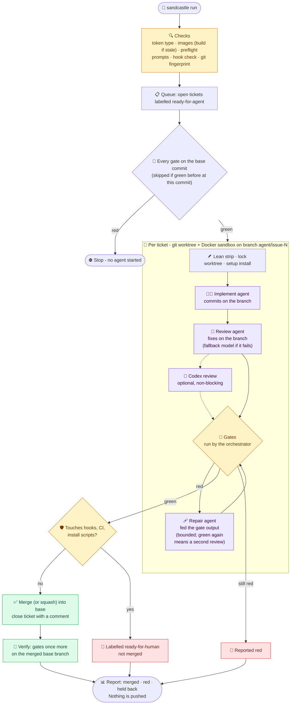

# How a run works

What the kit adds to Sandcastle, feature by feature, and the path one run takes.

## ✨ What it adds to Sandcastle

| | Feature | What you get |
|---|---|---|
| 🚦 | **Gates run by the orchestrator** | Your lint/build/test, run after the agents, in the sandbox. Only green branches merge, and the merged base branch is gated once more. A ticket behind its base has the base's tip merged into its branch in its sandbox just before its gates, and again once its gates slot is granted, if the base moved meanwhile, so a landing with no other landing in between needs no second gate run. |
| 🧱 | **A green base first** | Every gate runs on the base commit in the image before any agent starts. A gate red there would be red on every branch, so the run stops before it spends anything. |
| 🩹 | **Repair on red** | A ticket's first red gate is run again once before any repair, from that gate on (the gates after it, in config order, stopping at the first red), in the same sandbox and with no model: a red that was only the machine being busy goes on as green, with the line `<gate> red, then green on a re-run - a flake, no repair pass`. A re-run that goes red on the same gate, on tests the first red did not name at all (a flake each time), is followed by a third run, still with no repair pass; red on that too goes to repair, with the failing tests of all three runs in the prompt, and a test that went red and then green is listed on the ticket's run record as `flaked`. A gate with a `rerun` command (see `gates` in Configuration) runs that, filled with the failing tests, as its re-run and its third run, and the repair is still fed the first full run's output. A red landing gate (the merged tree, after the base moved) is run again once the same way before the ticket is requeued, so a requeue after one that went red twice, on an unmoved base, runs no gate: its repair starts from the landing gate's output. When every failing test of a red landing was already failing on the branch's own gates in this run, the line says `as seen on the branch before` and names no landed ticket, a flake that went green on a re-run included; a test that a repair commit then fixed is not counted, so a landed ticket that breaks it again is named. A red whose every failure is a test timeout, on a pass that read high machine-wide CPU pressure (60% or more; the sandbox's own figure is never judged), is the machine's load and not the branch's: it gets no repair pass and one more gate run instead, from the red gate on, with the line `<gate> red on test timeouts under machine load (CPU pressure N%) - no repair pass, gating once more`. Green there goes on as green; red on timeouts under high pressure again ends the ticket red with a note that says to run it again when the machine is quiet, still with no repair; red on anything else, or with the pressure fallen, goes to repair as below. With no reading (no PSI, a reading under 60, a red brought from a landing), or a gate that hit its own time bound, nothing changes, and the timed-out tests of a load red are never recorded as `flaked`. A red that comes back (never a timeout) gets one repair pass on the same warm sandbox, fed the gate's own output, then the gates run again - and up to two more while each pass commits and turns up a failure the last one did not see. A branch a repair turned green gets the review pass again, on the repair commits, before it can land. A pass that commits nothing (the repairer judged the red a flake) is not counted: the run's per-ticket line says `repair made no change`, and `repaired=N` counts only passes that committed. A pass that commits nothing and ends with `<verdict>outside-branch</verdict>` and a `Flaky:` line (the repairer judged the red not this branch's) is followed by one more gate run and no further pass, whatever attempts are left: green goes on, red ends the ticket red with that line in its note, and the tests it named are kept on the ticket's run record as `flaky`. The verdict counts for the whole run: a later ticket red on only those tests gets no repair pass and ends red with the first ticket's verdict in its note (`#N's repair judged it outside this branch: <line>`). A failure that is red on the base too, in a test file the branch did not change, gets no repair: the gates run once on the base's tip, and the closing summary names the test once under Needs you. |
| 🗂️ | **Your tracker** | Tickets are GitHub Issues (the default) or Markdown files in the repo - in the layout [Matt Pocock's setup skill](queue.md#-trackers-github-or-ticket-files) uses, so a repo that ran it works with no extra config. |
| 🔗 | **Ticket dependencies** | `Blocked by #12` in a ticket body, or a native "blocked by" edge on GitHub, holds it back until #12 is closed. It can also wait on a Linear issue (`ENG-42`) or an in-repo task file - see [Blockers](queue.md#-blockers-github-linear-ticket-files). |
| 🧑‍💻 | **Implement, then review** | Claude Sonnet 5.5 implements and tests at the ticket's seams, Claude Opus 5.5 reviews the tests as well as the code, on the same warm sandbox; a failed review falls back to the implementer's model. A `model:` or `effort:` label gives one ticket a different implementer. Optional third review by an OpenAI model through Codex (`CROSS_REVIEW=1`). |
| 🪶 | **Lean sandboxes** | The project's skills, subagents, commands and MCP servers are hidden from sandbox agents unless you keep them, and its plugins always, because each one costs context on every turn. |
| 🪝 | **Hooks enforced** | The project's Claude Code hooks are kept, and checked to be runnable in the image before any sandbox starts. |
| 🐳 | **One base image, a layer per project** | The base and a project's layer are rebuilt only when a Dockerfile changes; a Claude Code or Codex release rebuilds one shared agents image and copies it onto each project's image - see [The image's agent versions](configuration.md#-the-images-agent-versions). |
| 🛫 | **Preflight** | One short reply from every model before any sandbox starts, so an exhausted plan or a too-old CLI stops the run up front instead of halfway through. |
| ♻️ | **Picks up where it stopped** | A ticket re-run on its old branch builds on it instead of starting again, and a branch that was already green costs only the gates - see [Re-runs](running.md#-re-runs). A killed run's leftover sandboxes are stopped by the next run, `sandcastle land`, `gates` or `clean`. |
| 🛬 | **Landing you control** | Each ticket lands as soon as its gates are green, while the others still run, as a merge commit or squashed (`land`); a conflict, a red merge or a failed `setup` step is sent back once for a second try in the same run (a conflict's resolve waits for the branches that share its files and are past their review - in their gates, or green and queued - to land first), and a ticket whose last blocker lands starts at once. Between runs, `sandcastle preview` shows which unlanded branches would conflict, `sandcastle land <n>` merges and gates one by hand, and `sandcastle requeue <n>` sends one back with a note. `autonomy` lets one run take further turns by itself, up to `drain`. |
| 🔒 | **Host safety** | Fine-grained tokens only, host git hooks off during a run, the shared `.git` fingerprinted, risky branches held for a human merge (see [Safety model](safety.md#-safety-model)). |
| ⚖️ | **Machine-wide limits** | Several projects can run at once without starving each other. |
| 📺 | **A live status view** | `sandcastle status` in any terminal: every ticket of the run and where it is - working, ready to land, needing you, queued, blocked, merged - which gate is running, and when landing should start. |
| 🖥️ | **Best in [Herdr](https://herdr.dev)** | The run opens its own tab with the status view (in herdr-core, a terminal beside yours, which the next run replaces with its own under the same name), and rolls the run up in Herdr's sidebar (a pane per sandbox is opt-in) - see [Works best in Herdr](herdr.md#-works-best-in-herdr). |
| 🔭 | **A Claude Code mod** | Optional: the session that started the run shows it above the prompt, says when a ticket needs you, and is told when the run ends - see [The Claude Code mod](claude-mod.md#-the-claude-code-mod). |
| 🧩 | **An agent skill** | `/sandcastle` in Claude Code, `$sandcastle` in Codex, also read by OpenCode - for setup, auditing a repo for work, ticket triage, starting and closing runs, and updating. |

## 🔄 How it works

A run starts in a project, on its base branch, with a clean tree. It checks everything first,
then fans out one sandbox per ticket, up to `CONCURRENCY` at once and within the machine-wide limit.

A green gate run proves only that the configured gate commands passed on that branch - no more than
those commands check.
Whether the change does what the ticket asked is checked by the review agent, not the gates, which
is why every branch is reviewed before it is gated and a repaired branch is reviewed again.
A live run reaches the repair path less often because agents check their own work before they
finish: the implementer runs the typecheck gate and the tests its change touches or that cover it,
and leaves the full suite to the gates.
`SANDCASTLE_TEST_RED_GATE=1` (see the [Configuration](configuration.md#-configuration) table) counts each ticket's
first gate run as red to exercise it, at the cost of one repair pass per ticket.

The gates also run in the Linux sandbox, so a green run proves Linux only.
A branch can still be red on macOS or Windows (BSD tools, bash 3.2, shell shims and terminal flags
differ), and landing does not check that: it gates in the same Linux sandbox.
A project that ships to macOS or Windows can add a CI job on that OS, or run its gates on the host
before pushing.
