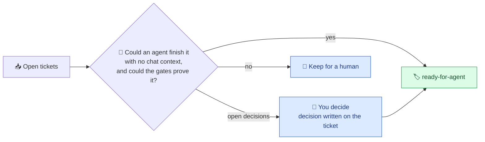

# Tickets and the queue

What makes a ticket ready for an unattended agent, how to mark it, blockers, and where tickets live.

## 📋 Queue: what agents work on

The queue is every open ticket marked `ready-for-agent` (a GitHub label, or a ticket file's
`Status:`; the value is `label` in `config.ts`).
Mark a ticket only when an agent with no chat context could finish it from the ticket and its
comments, and your gates could prove it.
The `/sandcastle queue` skill action walks every open ticket, gathers the facts, asks you the open
decisions in batches, writes each decision on its ticket, has a fresh subagent read the finished
ticket cold (where two readings of it would differ, you are asked), then labels it.
No tickets yet?
`/sandcastle audit` reviews the repo with read-only agents and files what they find, ready to queue.

A ticket that has to wait for another says so in its body: `Blocked by #12` or `Depends on #12`.
On GitHub a native "blocked by" edge (the issue's Relationships panel) holds it as well.
A colon is read too (`Blocked by: #12`); blockers listed under a `## Blocked by` heading are not,
and `sandcastle queue` warns about them.
A run holds it while #12 is open.
When #12 is in the same run, the ticket starts in that run, as soon as #12 has landed with its work
done, even if the tracker then refuses to close it (a chain of tickets drains in one run); a blocker
outside the run holds it for a later one.
A blocker can also live outside GitHub; see [Blockers](#-blockers-github-linear-ticket-files).
`sandcastle queue` lists the queue and what holds each ticket back.

A hard ticket can ask for a stronger implementer: a GitHub label `model:<id>`
(`model:claude-opus-5-5`) and/or `effort:<level>` sets the implement and repair passes for that
ticket only, over `IMPL_*` and `config.ts`. The run lists the override next to the ticket, refuses a
malformed label before anything starts, and preflight asks that model for a reply too. Reviews keep
the project's pair. Ticket files have no labels, so this is GitHub-only.

### 🏷️ How to mark a ticket ready

**On GitHub** (the default):

1. **Create the label once per repository.** In the repo, open **Issues > Labels > New label**
   and name it exactly `ready-for-agent` (or run
   `gh label create ready-for-agent --description "Ready for an unattended agent" --color 0E8A16`).
   If your team already uses another name, set `label` in `config.ts` instead. Until the label
   exists, `sandcastle doctor` in the project prints a `FIX` line with the command that creates it.
2. **Put it on an issue.** Open the issue, click the gear next to **Labels** in the right-hand
   sidebar and tick `ready-for-agent`.
   From a terminal: `gh issue edit 12 --add-label ready-for-agent`.
3. **Take it off to pull the ticket back.** The kit removes the label itself when it finishes.

**In ticket files:** add a line `Status: ready-for-agent` directly under the ticket's title and
commit it. See [Trackers](#-trackers-github-or-ticket-files).

**Before you do, check the ticket is ready.** An agent has only the ticket and the code, never your
chat. A good one says what should change, where to look, and how you will know it worked ("the
signup form rejects an empty email; `pnpm test` covers it"). If you are unsure, the
`/sandcastle queue` skill action reads your open tickets with you and only labels the ones that
qualify.

Where the queue lives is your choice - see [Trackers](#-trackers-github-or-ticket-files). Blockers
can also be Linear issues or ticket files.



### 🧷 Blockers: GitHub, Linear, ticket files

Only the ticket **body** is read (and, on GitHub, the issue's native "blocked by" edges): a
`Blocked by ...` line in a comment does nothing, and a run starts the ticket anyway.
Both `sandcastle run` and `sandcastle blockers` warn about that, and about comments whose blockers
are all closed (stale).
`sandcastle queue` and `sandcastle run` also warn, and `sandcastle blockers` lists, the queued
tickets a blocker would hold for good - one that does not exist, tickets that wait for each other, a
Linear blocker that cannot be read - a `Blocked by ENG-42` whose key `blockers.linear` does not
name, which is ignored, and blockers listed under a `## Blocked by` heading, which are not read.
They also name a queued spec that a queued child ticket names under `## Parent`: a run would
implement the whole spec as one ticket beside its children, so unqueue the spec.

| Named | Waits until | Enable |
|---|---|---|
| `Blocked by #12`, `Depends on #12` | issue or pull request #12 is closed or merged | always on |
| a native "blocked by" edge to issue #12 (GitHub only; `owner/repo#12` when the issue is in another repository) | issue #12 is closed (in its own repository); one closed as not planned never lets the ticket start; one gh cannot read counts as open, and so does a ticket whose own edges a run cannot read in time (`waits for #N's blocker links (could not be read)`): it starts once a later read gets them | always on; needs a gh that knows `blockedBy`, else one warning line and the body is read alone |
| `Blocked by ENG-42` | the Linear issue is in a *completed* or *canceled* state | `blockers.linear: ["ENG"]` and `LINEAR_API_KEY` |
| `Blocked by .scratch/checkout/issues/03-pay.md` | that file on the base branch has `Status: done` | the files tracker, or `blockers.files: { dir }` |
| `Blocked by: 01, 02` (a header line in a ticket file) | those tickets of the same feature are done | the files tracker |

Several may share a line: `Blocked by #12, ENG-42 and .scratch/checkout/issues/03-pay.md`.

Write the line as plain text.
One inside a code block or inline code (backticks) is an example, not a blocker, so a ticket can
quote blocker lines without waiting on them.

```ts
// .sandcastle/config.ts
blockers: {
  linear: ["ENG", "OPS"],                             // Linear team keys
  files: { dir: ".scratch", done: ["done", "shipped"] }, // where ticket files live; done defaults to done, closed, resolved, wontfix
},
```

- **Linear** needs a personal API key (read-only is enough) as `LINEAR_API_KEY` in
  `~/.config/sandcastle-kit/.env`, not the project's `.sandcastle/.env` (Sandcastle forwards that
  file into every container, so the kit refuses the key there).
  It stays on the host.
  `sandcastle doctor` checks it when `blockers.linear` is set.
- **Ticket files** are read from the base branch, not your working tree, so a blocker counts as done
  once its `Status:` change is committed there. Front matter (`status: done`) is read too.
- **Unreadable = open.** A missing Linear key, a network error or a missing file holds the ticket
  back; guessing wrong would start work on a missing foundation.

## 🗂️ Trackers: GitHub or ticket files

A tracker is where tickets live. The kit ships two:

| Tracker | Tickets are | Queue | Done |
|---|---|---|---|
| `github` (default) | GitHub Issues, through `gh` | open issues with the `label` | closed, label removed |
| `files` | Markdown files `.scratch/<feature>/issues/<NN>-<slug>.md` | files whose `Status:` equals the queue value | `Status: done`, committed on the base branch |

**Which one a project uses**, first match wins:

1. `tracker` in `.sandcastle/config.ts`: `"github"`, `"files"`, or
   `{ type: "files", dir: "tickets", done: [...] }`.
2. **Matt Pocock's setup, if the repo has it.**
   [`/setup-matt-pocock-skills`](https://github.com/mattpocock/skills) writes
   `docs/agents/issue-tracker.md` (`# Issue tracker: GitHub` or `Local Markdown`) and
   `docs/agents/triage-labels.md`.
   The kit reads both: the tracker from the first, and from the second the labels it uses for Matt's
   triage roles - the queue (`ready-for-agent`), the hold (`ready-for-human`), agents' follow-ups
   (`needs-triage`) and, for ticket files, `wontfix` as a done status.
   A repo that renamed a label needs no setting; without the file the kit uses Matt's names.
   GitLab and "other" trackers are noticed and reported by `sandcastle doctor`; the kit falls back
   to GitHub.
3. GitHub.

**Matt Pocock's skills are supported and recommended, never required.** Install
[his skills](https://github.com/mattpocock/skills) and run `/setup-matt-pocock-skills` in the
project: that writes `docs/agents/`, the kit detects it, and tickets that `/to-tickets` writes
(`.scratch/...`) or tickets that `/triage` labels `ready-for-agent` are picked up as they are - the
skills plan and shape the work, the kit burns it down unattended. Without them, `tracker: "files"`
and a `.scratch/` folder (or plain GitHub Issues) is the whole setup.

**The files layout** (Matt's "Local Markdown"):

```markdown
# Add the cart

Status: ready-for-agent
Blocked by: 01

What to build...

## Comments

### 2026-09-30 - sandcastle
Merged by the Sandcastle loop from `agent/issue-checkout-02`...
```

Keep `Status:` and `Blocked by:` as plain lines directly under the title, together: only that
block is read, so a "Status:" in the description below is just text. A value may be in backticks;
`Blocked by:` takes bare numbers (`01, 02`) for tickets of the same feature.

A ticket is named by its feature and number: `checkout-02` in branches (`agent/issue-checkout-02`),
logs and the status view. `sandcastle queue` lists the queue and what holds each ticket back;
`sandcastle doctor` says which tracker was chosen and why.

**Who writes to the tracker.** With GitHub, agents comment and label themselves, as before.
With `files`, agents write nothing to the tickets: they end with `<report>...</report>` (or
`<blocked>...</blocked>` to hand the ticket to a human), and the orchestrator posts it, commits it
to the base branch and marks the ticket `done` or `ready-for-human`.
That keeps ticket files out of the agents' branches, and the GitHub token out of the sandbox when
nothing needs it (a `files` project does not require `GH_TOKEN`).

**Limits.** The `files` tracker needs the run to start from a clean base branch (it commits ticket
changes there). Linear as a full tracker is not built; Linear issues work as blockers today.
